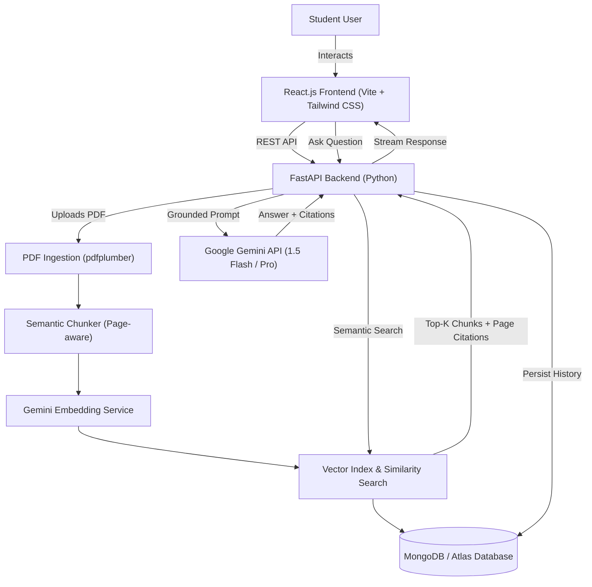

# 🎓 AI Study Assistant (RAG + Gemini + FastAPI + React + MongoDB)

An intelligent full-stack AI Study Assistant that ingests PDF notes, textbooks, and lecture slides, retrieves the most relevant information using **Retrieval-Augmented Generation (RAG)**, and answers student questions grounded with **exact page citations** using the **Google Gemini API**.

---

## 🚀 Key Features

1. **📄 PDF Ingestion & Semantic Chunking**:
   - Parses multi-page PDF documents page by page using `pdfplumber`.
   - Splits text into contextual sliding window chunks preserving page numbers.
   - Computes semantic vector embeddings via Gemini `models/text-embedding-004` (with hybrid lexical boost).
2. **💬 RAG Chat with Page Citations**:
   - Retrieves top matching passages for each query.
   - Injects verified context into Gemini prompts to eliminate hallucinations.
   - Outputs interactive `[Page X]` citation badges that open full source excerpts on click.
3. **🃏 Active Recall Flashcards**:
   - Generates high-yield study flashcards with interactive 3D flip animation.
   - Includes hint reveals, mastery tracking ("Mastered" / "Needs Review"), and Gemini regeneration.
4. **📝 Practice Quiz (MCQs)**:
   - Auto-generates multiple choice questions with immediate feedback, detailed explanations, and score tracking.
5. **📋 Study Guide & Summary Generator**:
   - Synthesizes executive overviews, key takeaways, important terms glossary, and exam preparation tips.
6. **💾 MongoDB Database & Resilient Storage**:
   - Stores documents, chunks, chat history, and study sets in MongoDB.
   - Seamlessly falls back to resilient in-memory mode if MongoDB is not running locally.
7. **⚡ Built-in Pre-loaded Notes**:
   - Comes with a pre-generated sample PDF study guide on *"Artificial Intelligence and Machine Learning Fundamentals"* for instant 1-click exploration.

---

## 🏛️ System Architecture



---

## 🛠️ Tech Stack

| Layer | Technology | Purpose |
|---|---|---|
| **Frontend** | React 19, Vite, Tailwind CSS v4, Lucide React | Modern study dashboard, chat UI, 3D flashcards, quiz interface |
| **Backend** | FastAPI, Python 3.14, Uvicorn, Pydantic | Asynchronous REST API, RAG orchestration, study tools generator |
| **AI / LLM** | Google Gemini API (`gemini-1.5-flash`, `text-embedding-004`) | Context-grounded synthesis, embeddings, flashcard and quiz creation |
| **RAG Engine** | `pdfplumber`, NumPy, Scikit-learn | Multi-page text extraction, sliding chunking, cosine similarity retrieval |
| **Database** | MongoDB / Motor / PyMongo | Persistence of documents, vector chunks, chat history, and study sets |

---

## 📂 Project Structure

```
ai-study-assistant/
├── backend/
│   ├── app/
│   │   ├── config.py             # Environment configuration & dynamic API key manager
│   │   ├── database.py           # MongoDB connection & resilient fallback store
│   │   ├── main.py               # FastAPI entry point, CORS, and router bindings
│   │   ├── models/
│   │   │   └── schemas.py        # Pydantic schemas for requests and responses
│   │   ├── rag/
│   │   │   ├── pdf_processor.py  # PDF text extraction & page-preserving chunking
│   │   │   ├── embeddings.py     # Gemini & fallback vector embeddings
│   │   │   ├── vector_store.py   # Hybrid vector similarity retrieval
│   │   │   └── rag_engine.py     # RAG prompt synthesis & study tool generators
│   │   └── routers/
│   │       ├── chat.py           # QA chat endpoint & conversation history
│   │       ├── documents.py      # Upload PDF, document list, chunk inspection
│   │       ├── health.py         # System health, MongoDB status, key configuration
│   │       └── study_tools.py    # Flashcards, Quizzes, and Summary endpoints
│   ├── sample_data/
│   │   ├── create_sample_pdf.py  # Sample notes generator (ReportLab)
│   │   └── AI_Study_Guide_Notes.pdf
│   ├── requirements.txt
│   ├── run.py                    # Backend server runner
│   └── .env
├── frontend/
│   ├── src/
│   │   ├── App.jsx               # Main React application & tab switcher
│   │   ├── components/
│   │   │   ├── CitationBadge.jsx # Source citation badge with excerpt modal
│   │   │   ├── ChatInterface.jsx # RAG conversational QA interface
│   │   │   ├── DocumentUpload.jsx# PDF upload & document vault
│   │   │   ├── FlashcardsView.jsx# 3D interactive flip study cards
│   │   │   ├── Navbar.jsx        # Navigation bar & system status indicators
│   │   │   ├── QuizView.jsx      # Interactive MCQ quiz with instant grading
│   │   │   ├── SettingsModal.jsx # Gemini API key & MongoDB settings modal
│   │   │   └── SummaryView.jsx   # Structured study guide & glossary
│   │   ├── services/
│   │   │   └── api.js            # Frontend API client
│   │   └── index.css             # Tailwind styling & 3D card transforms
│   ├── package.json
│   └── vite.config.js
├── start-app.bat                 # One-click launcher for Windows
├── start-backend.ps1             # PowerShell backend runner
├── start-frontend.ps1            # PowerShell frontend runner
└── README.md
```

---

## ⚡ Quick Start

### 1. Configure Gemini API Key

1. Get a free API key from [Google AI Studio](https://aistudio.google.com/app/apikey).
2. You can either:
   - Add it directly in `backend/.env`:
     ```env
     GEMINI_API_KEY=your_key_here
     ```
   - **OR** paste it directly into the web UI by clicking the **Settings (⚙️)** button in the top navigation bar!

### 2. Configure MongoDB (Optional)

- If MongoDB is installed locally, ensure it is running on `mongodb://localhost:27017`.
- If using MongoDB Atlas, paste your connection string in `backend/.env`:
  ```env
  MONGODB_URI=mongodb+srv://<user>:<password>@cluster0.mongodb.net/?retryWrites=true&w=majority
  ```
- *If MongoDB is not installed, the application will automatically run in Resilient In-Memory Mode without crashing!*

### 3. Launch the Application

#### Option A: One-Click (Windows)
Double-click `start-app.bat` or run:
```powershell
.\start-app.bat
```

#### Option B: Terminal Windows

**Backend:**
```powershell
cd backend
python run.py
```
- API is live at: `http://localhost:8000`
- Interactive Swagger docs: `http://localhost:8000/docs`

**Frontend:**
```powershell
cd frontend
npm run dev
```
- App UI opens at: `http://localhost:5173`

---

## 💡 How RAG Works in This Application

1. **Extraction**: When you upload a PDF, `pdfplumber` extracts raw text page-by-page.
2. **Chunking**: The document is partitioned into ~800-character windows with a 150-character overlap to retain context across sentence breaks.
3. **Embedding**: Text chunks are embedded into high-dimensional vector representations.
4. **Retrieval**: When you ask a question, your query is embedded and compared against document chunks using **Cosine Similarity** + keyword overlap boosting to find the top $K$ relevant chunks.
5. **Grounded Generation**: The retrieved passages are inserted into Gemini's prompt with page numbers. Gemini responds with clear explanations and page citations.
